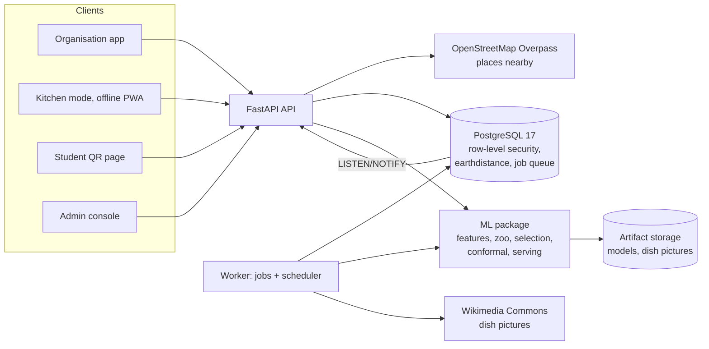

# FoodWise

Demand forecasting, student feedback and surplus rescue for college canteens and hostel messes.

FoodWise tells a mess manager **how much of each dish to cook tomorrow** (with an honest range, not a single guess), learns from **what students actually think**, and when cooked food is left over, **finds the places near you that feed people** (community kitchens, gurdwara langars, food banks, shelters, children's and elders' homes) inside the food-safety window.

Each organisation has **one shared sign-in** for everyone who plans food. FoodWise engineers have a separate **admin console** for model health and how the service is running. Every organisation's models are trained only on its own data.

> The original design document is preserved in git history (first commit). This README describes the system as built, including where the design was changed and why.

## What's in the box

| Area | What works today |
|---|---|
| **Two sign-ins** | One organisation account (managers, cooks, anyone who plans food) that can do everything inside its organisation; a separate admin sign-in for FoodWise engineers. Each sign-in page accepts only its own kind of account |
| **Prep plan** | Per dish and meal: a full forecast distribution (11 quantiles), a cost-optimal quantity (newsvendor), plain-language reasons ("Rain forecast −6%, Exam week −9%, 1,040 RSVPs"), approve or override with a reason |
| **Model zoo** | Two baselines (seasonal naive, weighted mean), elastic net, extra trees, histogram gradient boosting, and a non-negative ensemble of the three, chosen per canteen by walk-forward backtest |
| **Honest uncertainty** | Conformal intervals from out-of-fold errors, grouped by meal and by unusual days; promotion gates on skill, calibration, bias and simulated cost |
| **Champion / challenger** | New winners shadow the champion on days they have never seen; promotion only if they win live. Drift and shortage-rate monitoring, rollback |
| **Censored demand** | Sold-out servings are imputed (not trusted as demand) so running out doesn't teach the model to cook less |
| **Cold start** | Readiness tiers: a labelled rule-based plan from day one, more models as history grows |
| **Bring your own data** | CSV/Excel import with fuzzy column and dish matching, a data-quality report and dry run before commit |
| **Kitchen log** | Phone-first, English/Hindi, three inputs per dish, works offline (IndexedDB queue, idempotent sync) |
| **Live service** | Intraday stock checks, depletion-curve projection, batch-cooking advice, early surplus warning |
| **Students** | QR page with one-tap ratings, aspects, comments in any language (Hinglish-aware sentiment, PII scrubbing), RSVPs that feed the forecast, weekly votes; scores hidden below a k-anonymity floor |
| **Surplus rescue** | Threshold check, food-safety gate (configurable windows), then **places nearby from OpenStreetMap** around your device's location (or the canteen): ranked by distance, kind of place, whether they can be phoned, opening hours and your history with them. Call, WhatsApp (with a ready-made message), directions, or "find their number". Record who agreed to take how many portions (concurrent records cannot over-allocate), the weighed handover, and impact. Food past its safe window switches to animal shelters, gaushalas and compost. Live updates (SSE) |
| **Dish pictures** | Every dish gets a photo automatically: the lead image of its Wikipedia article or the best-matching freely licensed photo on Wikimedia Commons, with the photographer and licence credited. Kitchens can pick another or upload their own (cropped square, location and camera metadata removed). Shown in the menu, prep plan, kitchen log, live service, rescues, feedback and the student page |
| **Admin console** | For engineers: champion and challenger per canteen, live forecast error by day, calibration, bias, shortage rate and drift with alerts, one-click retrain; API request rate, errors and latency per route; job queue, dead letters and worker heartbeats; database size, connections and table health; external service health (OpenStreetMap, Wikimedia, Open-Meteo); real-user Core Web Vitals; sign-in security. Aggregates only, never an organisation's records |
| **Impact** | Waste before vs after on the college's own logs with a bootstrap interval, shown alongside sell-out rates; kg, ₹, CO2e, meals; PDF and CSV export |
| **Platform** | Multi-tenancy enforced by PostgreSQL row-level security, two account kinds, rotating refresh tokens, append-only audit trail, signed webhooks, job queue, Prometheus metrics |

## Architecture



| Layer | Choice |
|---|---|
| Web | React 19, Vite 7, TypeScript, Tailwind 4, TanStack Query, Recharts, Leaflet, types generated from the API's OpenAPI |
| API and worker | Python 3.12+, FastAPI, SQLAlchemy 2, Alembic, Pydantic 2 |
| ML | pandas, scikit-learn, LightGBM, SciPy (in-process; training runs in workers) |
| Data | PostgreSQL 17 only: tenant data, model registry, `SKIP LOCKED` job queue, `LISTEN/NOTIFY` for live updates |

### Changes from the original design, and why

| Design said | Built | Reason |
|---|---|---|
| Node API + separate Python ML service | One Python backend; ML in-process, training in worker processes | The feature builder is shared by training and serving with no network contract between them (no train/serve skew) |
| MongoDB | PostgreSQL | The data is relational; RLS enforces tenant isolation in the database itself; transactional atomic claims; `earthdistance` covers geo matching |
| Redis + BullMQ | PostgreSQL job queue | One fewer service; retries, delays, dedupe and dead-lettering on `FOR UPDATE SKIP LOCKED` |
| SHAP explanations | Counterfactual reason codes | Same method for every model in the zoo, and reads as "rain −6%" directly |
| MAPIE | Hand-written conformal calibration | Grouped by meal and unusual days; no extra dependency |
| P10/P50/P90 | 11-quantile grid | The newsvendor quantity is read exactly at any service level |
| Separate student app | Lazy-loaded route in one web app | Students download only the small public bundle |
| Six staff roles and a partner portal | One shared organisation login, plus an admin login | Canteens share devices and staff change often; one account per organisation is what they actually use. Engineers get their own console instead of a role inside each college |
| Partner NGOs register, get verified and receive alert waves | Places nearby are found on OpenStreetMap from the device's location; staff call them and record who agreed | Nobody has to sign up before food can reach them, and there is no register of organisations to keep current. FoodWise suggests; people decide. Past donations make a place rank higher next time |
| Text-only menus | Dish pictures from Wikimedia Commons, or the kitchen's own photo | Recognising a dish at a glance in the kitchen and on the student page |

## Run it

Requirements: Docker, Python with [uv](https://docs.astral.sh/uv/), Node 20+.

```bash
docker compose up -d db
```

```bash
cd backend && uv sync && uv run foodwise migrate && uv run foodwise seed
```

```bash
cd backend && uv run foodwise api --port 8000
```

```bash
cd backend && uv run foodwise worker
```

```bash
cd web && npm install && npm run dev
```

Open http://localhost:5173 and pick a demo organisation, or http://localhost:5173/admin/login for the admin console (development only; the seed refuses to run, and the API refuses to start, in production with demo accounts present). Demo password: `foodwise-demo`.

Dish pictures and nearby places need internet access (Wikimedia Commons and OpenStreetMap); the worker fetches the pictures after seeding and refreshes each canteen's surroundings daily. Without internet everything else works, and dishes show their initials instead of a photo.

The whole stack in containers: `docker compose up --build`, then http://localhost:8080.

### The demo college is a running simulation

`foodwise seed` builds Sahyadri Institute of Technology (fictional, sign in as `team@sahyadri.example`) as a **digital twin**: true demand comes from a simulated semester calendar, Pune weather, exams, fests and dish quality. Eight months are planned by hand, then FoodWise trains a champion and the simulated kitchen cooks FoodWise's plans for three weeks against that true demand; a weekly retrain produces a challenger that must win a shadow week. Every accuracy, waste and model figure in the demo is an output of the system, not a number written into the database. A daily `demo_tick` job keeps the twin running, so the demo stays current. A second college, Riverside (`team@riverside.example`), signed up ten days ago and shows the cold-start tier. The admin account is `admin@foodwise.example`.

## Tests

```bash
cd backend && uv run pytest
```

129 tests: business rules (newsvendor, safety gate, OpenStreetMap place classification, opening hours and ranking, dish-picture matching, data quality, text analysis), ML guarantees (a leakage test that perturbs future rows, time-ordered folds, conformal coverage, a golden-dataset test that learned models beat baselines), and database flows (cross-tenant 404s on every endpoint and at the RLS level, organisation and admin sign-in separation, password change signing out other devices, refresh-token reuse detection, lockout, the full rescue flow with two people recording donations at the same moment, place search when OpenStreetMap is down, picture upload metadata stripping, the Web Vitals beacon, imports, the job queue). Database tests use the `foodwise_test` database from `docker compose up -d db`; OpenStreetMap and Wikimedia are faked.

```bash
cd web && npx tsc -b
```

## Repository layout

```text
backend/foodwise/
  api/        HTTP routers (auth, tenant, catalog, logs, imports, forecasts, models, feedback,
              public, incidents, places, media, impact, live, webhooks, ops, health)
  core/       config, RLS sessions, security, accounts, jobs, events, telemetry, geo, storage
  domain/     pure rules: newsvendor, safety, places, data quality, readiness, text analysis
  ml/         features, zoo, conformal, selection, training, serving, explain, monitoring, registry
  services/   rescue engine, places (Overpass), dish pictures (Wikimedia), webhooks, weather
  sim/        the simulated college, seed, daily demo tick
  tasks.py, worker.py, main.py, cli.py
backend/migrations/   Alembic (schema, RLS policies, append-only audit trigger)
backend/tests/
web/src/      app shell and auth, api client and hooks, pages (incl. admin/), ui (design system, DemandShape,
              DishPhoto, PlaceFinder, charts, map), lib (location, web vitals, offline queue)
infra/        Postgres init, Dockerfiles, nginx
```

## Status and known gaps

Verified in this build: the backend test suite, web typecheck, and the main staff pages reviewed in a browser. Not yet done:

- Browser review of every page at phone width, and end-to-end Playwright tests
- Docker images built and run end to end (Dockerfiles are written but untested)
- CI workflow, college SSO (OIDC), S3 storage adapter, inventory and procurement (stretch)
- An organisation sign-up page (organisations are created by the seed or by an engineer today)
- OpenStreetMap coverage of NGOs and shelters varies by city, and phone numbers are often missing; staff can add a place they know to a rescue, and it is remembered for next time
- Food-safety windows and legal wording must be reviewed by the college's food-safety officer and counsel before real donations

Past rescue recipients in the demo history are fictional and marked "(demo)"; live suggestions are real places from OpenStreetMap, so call before sending food.
